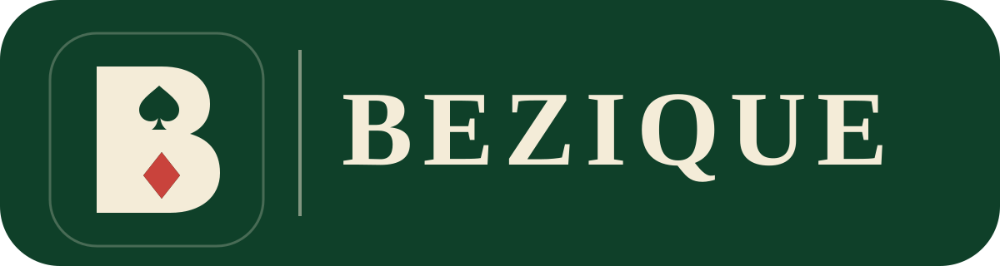

<p align="center"></p>

# Bezique

A single-player [Bezique](https://en.wikipedia.org/wiki/B%C3%A9zique) card game that runs entirely in the browser, with computer opponents of three abilities and an optional tutor that explains its move recommendations.

**Play it:** <https://eddporter.github.io/bezique/>

## Features

- Three variants, each driven by a configuration of one rules engine: Rubicon Bezique (128 cards), Chinese (Six-Pack) Bezique (192 cards) and Classic Bezique.
- Three computer opponents: Novice, Club Player and Expert.
- A tutor that suggests a move and explains the reasoning; it can be switched off.
- An in-app help sheet listing meld and hand values.
- A cheat mode that reveals the opponent's hand.
- Card animation, and hand sorting by suit and rank or grouped by meld.
- No server, no accounts: everything is client-side.

## Development

Requires Node.js 20 or later.

```sh
npm install
npm run dev        # start the development server
npm test           # run the test suite
npm run typecheck  # type-check without emitting
npm run build      # production build into dist/
```

`npm run optimize:expert` runs the offline weight-tuning harness for the Expert opponent (see `scripts/`).

## How it is organised

| Path | Contents |
|---|---|
| `src/engine/` | Pure, serialisable rules engine: cards, melds, tricks, scoring and per-variant rulesets. No DOM. |
| `src/agents/` | Human, computer and tutor agents; they produce moves and never touch the UI. |
| `src/ui/` | React interface and animation. |
| `test/` | Vitest suites for the engine and agents. |
| `docs/` | Rules specifications, architecture plan, AI strategy notes and the project brief. |

Start with [`docs/PROJECT-BRIEF.md`](docs/PROJECT-BRIEF.md) for scope and decisions, and [`docs/bezique-rules-spec.md`](docs/bezique-rules-spec.md) for the rules as implemented.

## Deployment

Pushes to `main` are type-checked, tested, built and published to GitHub Pages by `.github/workflows/deploy.yml`.

## Rules sources

The Rubicon rules follow the 1887 Portland Club code (via *Hoyle's Games Modernized*), cross-checked against Pagat.com; full citations are in the rules specifications under `docs/`.

## Licence

The source code and documentation are licensed under the [PolyForm Noncommercial License 1.0.0](LICENSE): free for personal, educational and other noncommercial use, but not for commercial use. For a commercial licence, contact the author via their [GitHub profile](https://github.com/EddPorter).

The logo is not covered by that licence and is reserved. "Bezique" is the name of a traditional card game and is not claimed by this project.
